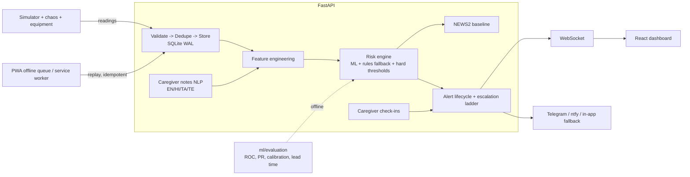

# Architecture

## Core flow
`SENSE → UNDERSTAND → PREDICT → ALERT → RESPOND`

```
apps/simulator (software IoT)
        │  synthetic sensor readings (event_id, patient_id, vitals, device_state, connectivity)
        ▼
apps/api/validation.py   VALIDATE  — whitelist fields, strip `_true_severity`, range-check vitals
        ▼
apps/api/pipeline.py     DEDUPE    — reject events whose event_id was already stored
        ▼
                         STORE     — database/models.py SensorReading (or InMemoryRepository in this
                                     sandbox, same interface — see database/README below)
        ▼
ml/features/engineering.py   FEATURE ENGINEERING — rolling-window stats + patient context + NLP note signals
        ▼
services/risk_engine/engine.py   RISK — trained model (ml/inference) with a rules-based fallback and
                                  an unconditional hard-threshold safety net (services/risk_engine/rules.py)
        ▼
services/alert_engine/engine.py  ALERT — severity classification, deduplication, lifecycle
                                  (DETECTED → ALERTED → ACKNOWLEDGED → ESCALATED → RESPONDED → RESOLVED)
        ▼
apps/api/ws_manager.py   NOTIFICATION — broadcast over WebSocket to every connected frontend client
        ▼
database TimelineEvent / apps/api/repository.py   TIMELINE — durable append-only history per patient
```

## Why one system, not three
IoT (the simulator), AI/ML (risk_engine + ml/*), and full-stack (apps/api, and the frontend to come)
are wired through a single pipeline object (`IngestionPipeline.ingest`), not three demos glued
together after the fact. A single call to `ingest()` is the only integration point simulated sensor
data needs to reach the ML models, the alert lifecycle, and (once connected) the browser.

## Layering and what is/isn't executable in this sandbox
| Layer | Files | Executable here? |
|---|---|---|
| IoT simulator | `apps/simulator/*` | Yes (smoke-tested in a prior session) |
| Feature engineering | `ml/features/*` | Yes (used throughout the test suite) |
| Synthetic data generator | `ml/data/generator.py` | Yes (14/14 tests) |
| ML training/inference/explainability | `ml/training`, `ml/inference`, `ml/explainability` | Yes |
| Risk engine (rules + model + safety net) | `services/risk_engine/*` | Yes |
| Alert engine (lifecycle, dedup, escalation) | `services/alert_engine/*` | Yes (24/24 tests) |
| Ingestion pipeline (framework-free) | `apps/api/pipeline.py`, `validation.py`, `repository.py` | Yes (17/17 tests) |
| NLP engine | `services/nlp_engine/*` | Yes (20/20 tests) |
| Offline sync queue | `services/sync_engine/queue.py` | Yes (12/12 tests) |
| JWT token issuance/verification | `apps/api/auth.py` (token part only) | Yes (4/4 tests) |
| SQLAlchemy models/session/seed | `database/*` | **No** — sqlalchemy not installed, no network |
| FastAPI HTTP routes + WebSocket | `apps/api/main.py`, `ws_manager.py` | **No** — fastapi/uvicorn not installed, no network |
| Password hashing (bcrypt) | `apps/api/auth.py` (hash/verify part) | **No** — bcrypt not installed |
| React frontend | not started | **No** — out of scope for this session (see STATUS.md stop condition) |

See `docs/testing.md` and `STATUS.md` for the authoritative, up-to-date pass/fail counts.

## Diagram (Mermaid; renders on GitHub)

